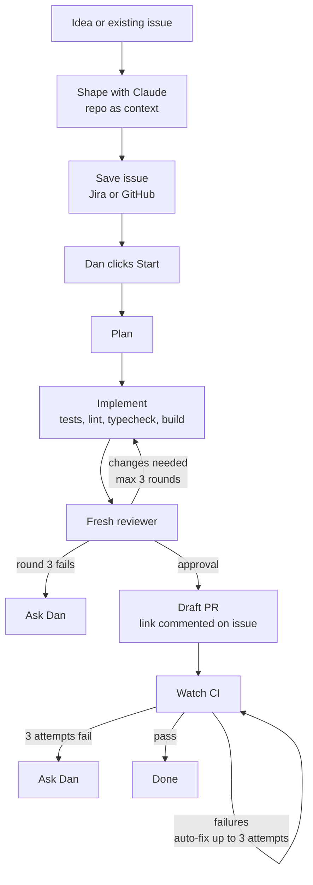

# Flightdeck v2 design

Decided with Dan on 12 Nov 2026. The previous version is archived on the `v1-archive` branch.

## Goal
A local app on my Mac where I go from an idea to a draft PR with Claude, across many repos at once. I shape the goal with Claude, using the GitHub repo for context, and save it as a Jira or GitHub issue. Then an agent works hands-off in its own worktree: it plans, implements, reviews its own work and fixes it up to 3 times, then opens a draft PR. It only stops to ask me when it's stuck. When I'm asked to review someone's PR, Claude gives me a summary and drafts review comments, and nothing gets posted until I approve it.

- Runs on: Dan's Mac, local agents (Claude Agent SDK)
- Form: desktop or local web app
- Trackers: Jira Cloud and GitHub Issues
- Code host: GitHub

## Flow

## 1. Shaping a goal into an issue
- Start from a new idea in a chosen repo, or an existing Jira or GitHub issue to refine.
- Back-and-forth chat: Claude reads the repo, asks questions, then drafts the issue.
- Issue contents: goal and background, acceptance criteria, relevant files and code areas, suggested implementation approach, out of scope, test plan.
- Dan picks Jira or GitHub each time.
- After saving, it waits until Dan clicks Start.

## 2. Running a change
1. Plan: the agent writes a plan in its worktree. The plan stays in the app only.
2. Implement: the repo's tests, lint, typecheck and build must all pass before review.
3. Review: a separate Claude session with fresh context reviews the diff and checks every acceptance criterion.
4. Loop: implement and review repeat up to 3 rounds. If round 3 still fails, stop and ask Dan.
5. Draft PR: open a draft PR and comment the PR link on the issue.
6. CI: watch CI and fix failures automatically, up to 3 attempts, then ask Dan.
Throughout, the agent is hands-off but can pause and ask Dan a question when stuck.

## 3. Many changes at once
- A max number of concurrent agents, set in Settings.
- Every change runs in its own git worktree, including several on the same repo.
- The app clones repos into its own folder and manages worktrees.
- One repo per issue.
- An Archive button removes the worktree when done.

## 4. Reviewing others' PRs
- Kept separate from Dan's own changes and PRs.
- Dan selects which PRs he's reviewing.
- Claude reviews only when Dan clicks Review.
- Creates a worktree at the PR's commit and runs an agent using the repo's own review skill, or a built-in default review (bugs, tests, security, acceptance criteria) when the repo has none.
- Output: a summary plus drafted line comments.
- Dan approves or edits each comment, then posts them together as one review with a verdict he picks.
- Dan can chat with Claude about the PR.

## Still to decide
1. Tech stack (v1 used TypeScript Node + React + Claude Agent SDK).
2. Whether to keep per-run and daily dollar caps alongside the concurrency limit.
3. Screens: home screen and layout of runs, issues and reviews.
4. Build order.
