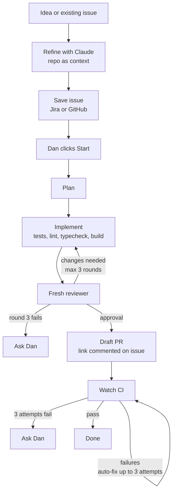

# Flightdeck v2 design

Decided with Dan on 12 Nov 2026. The previous version is archived on the `v1-archive` branch.

## Goal
A local app on my Mac where I go from an idea to a draft PR with Claude, across many repos at once. I refine the goal with Claude, using the GitHub repo for context, and save it as a Jira or GitHub issue. Then an agent works hands-off in its own worktree: it plans, implements, reviews its own work and fixes it up to 3 times, then opens a draft PR. It only stops to ask me when it's stuck. When I'm asked to review someone's PR, Claude gives me a summary and drafts review comments, and nothing gets posted until I approve it.

- Runs on: Dan's Mac, local agents (Claude Agent SDK)
- Form: desktop or local web app
- Trackers: Jira Cloud and GitHub Issues
- Code host: GitHub

## Flow

## 1. Refining a goal into an issue
- Start from a new idea in a chosen repo, or an existing Jira or GitHub issue to refine. The UI calls this Refine (routes `/refine/:id`; `/shape/:id` still works).
- Back-and-forth chat: Claude reads the repo, asks questions, then drafts the issue.
- Issue contents: goal and background, acceptance criteria, relevant files and code areas, suggested implementation approach, out of scope, test plan.
- Dan picks Jira or GitHub each time.
- After saving, it waits until Dan clicks Start.

## 2. Running a change
1. Plan: the agent writes a plan in its worktree. The plan stays in the app only.
2. Implement: the repo's tests, lint, typecheck and build must all pass before review.
3. Review: a separate Claude session with fresh context reviews the diff and checks every acceptance criterion.
4. Loop: implement and review repeat up to 3 rounds. If round 3 still fails, stop and ask Dan.
5. Draft PR: open a draft PR and comment the PR link on the issue.
6. CI: watch CI and fix failures automatically, up to 3 attempts, then ask Dan.
Throughout, the agent is hands-off but can pause and ask Dan a question when stuck.

## 3. Many changes at once
- A max number of concurrent agents, set in Settings. Starts beyond the cap are queued and start automatically when a slot frees.
- A run waiting on Dan for an answer (or after three failed reviews) keeps its slot. Watching CI does not hold a slot; auto-fix reclaims one through the normal claim path when the agent needs to run.
- Every change runs in its own git worktree, including several on the same repo.
- The app clones repos into its own folder and manages worktrees. Live worktrees live at `<clone>/.flightdeck/<changeId>` (gitignored via `.git/info/exclude`). `git worktree prune` runs on startup; archive force-removes the worktree, prunes and retries on failure, then deletes the change branch.
- One repo per issue.
- Interrupted runs (process restart) stay in their stage and show one-click Resume. They keep the slot until resumed or archived.
- An Archive button removes the worktree when done (and for queued or interrupted runs).

## 4. Reviewing others' PRs
- Kept separate from Dan's own changes and PRs.
- Dan selects which PRs he's reviewing.
- Claude reviews only when Dan clicks Review.
- Creates a worktree at the PR's commit and runs an agent using the repo's own review skill, or a built-in default review (bugs, tests, security, acceptance criteria) when the repo has none.
- Output: a summary plus drafted line comments.
- Dan approves or edits each comment, then posts them together as one review with a verdict he picks.
- Dan can chat with Claude about the PR.

## Stack
- Local web app opened in the browser (Node server bound to 127.0.0.1).
- TypeScript Node backend with the Claude Agent SDK; React frontend with MUI.
- SQLite at `~/.flightdeck/app.sqlite`. Schema version is `PRAGMA user_version` (currently 11: `changes.ci_round`, `changes.ci_phase`, `changes.ci_pushed_at`, `pull_requests`, `pr_reviews`, `pr_review_comments.placement`, `pr_review_messages`, and `pr_review_events`). Startup creates missing tables and `ALTER TABLE`s missing columns (checked with `PRAGMA table_info`). An incompatible v1 database is renamed to `app.sqlite.v1-backup-<timestamp>` and replaced with a fresh v2 file — never deleted silently.
- Claude auth: use `apiKeyHelper` and the API base URL (ANTHROPIC_BASE_URL) from the user's Claude settings (`~/.claude/settings.json`); fall back to the Claude OAuth login when no `apiKeyHelper` is set.
- GitHub via `GITHUB_TOKEN` (then `GH_TOKEN`) in the environment, else a personal access token in Settings (Octokit; git CLI still does clone/fetch/worktree/commit/push via `GIT_ASKPASS` with the resolved token). The env token is never logged or written to the keychain. Jira Cloud via email + API token.
- Per-run and daily dollar caps (daily spend is the Mac-local calendar day, not UTC), plus a max-concurrent-agents setting. A live cap hit aborts the in-flight Claude query and stops the run with the reason shown. PR chat uses the same caps and abort path; it does not occupy a concurrent-agent slot.

## Caching
Live GitHub, Jira and Claude calls are keyed TTL caches with in-flight dedupe (`features/cache`). Failed loads are not cached. Demo mode never calls the live trackers. Exception: Agent SDK conversations (`features/agent`: refine, plan, implement, review, CI fix) are streaming and non-repeatable, so they are not cached; only `detectClaudeConfig` is. Their cost and abort handling live in the run engine caps.

| Call | TTL | Invalidation |
|---|---|---|
| Issues tracker sync (`GET /api/issues`) | 60s | `POST /api/issues/sync` (Refresh) forces a sync |
| GitHub `GET /user` (token status) | 2 min | Preflight only (`checkGithub` via startup `runChecks` and `POST /api/preflight/recheck`). Issue sync does not call it; token save invalidates `gh:status` without calling GitHub |
| GitHub assigned issues search (paginated, 100 per page) | 60s | Refresh; after GitHub issue create/update |
| GitHub `GET /user/repos` (paginate `/user/repos` with `affiliation=owner,collaborator,organization_member`) | 1 hour (in-memory + SQLite `github_repos_cache`) | Picker Refresh (`GET /api/repos?refresh=1`); GitHub token save/disconnect deletes `github_repos_cache` and `gh:repos` |
| Jira JQL search | 60s | After Jira create/update; Refresh |
| Jira connect `myself` | 2 min | After Jira create/update (not Settings save) |
| `detectClaudeConfig` (including apiKeyHelper) | 2 min | `POST /api/preflight/recheck` |
| `git fetch origin` | 60s | TTL only |
| GitHub authored open PRs (GraphQL `search`; REST `is:pr is:open author:@me` fallback) | 60s TTL | Token save/disconnect (`gh:pulls`). GraphQL is TTL-only; the REST fallback uses `If-None-Match` / 304 |
| GitHub combined status + check-runs for a ref | 20s | Token save/disconnect (`gh:checks:*`); CI watch refetches with `fresh` + ETag |
| GitHub `pulls.get` (PR state for CI watch / parked slot) | 20s | Token save/disconnect (`gh:pull:*`); `If-None-Match` / 304 |
| GitHub `pulls.listFiles` (review comment placement) | 20s | Token save/disconnect (`gh:pull-files:*`); `If-None-Match` / 304 |
| GitHub review-requested PRs (`search` `review-requested:@me`, then `pulls.get` for head SHA) | 60s | `GET /api/reviews` and Reviews Refresh (`POST /api/reviews/refresh` with `fresh`); token save/disconnect (`gh:reviews`); search uses `If-None-Match` / 304; head SHA reuses `gh:pull:*`. Stored non-archived rows are never dropped when GitHub returns none |

`issues.updated` is published only when a sync ran and data changed, or after save / setIssueRepo — never on a GET cache hit, so the Issues page can refetch the store without looping into GitHub/Jira. On HTTP 429 (Jira `Retry-After`) or GitHub 403/429 (`Retry-After`, `x-ratelimit-reset`, secondary rate limit), Octokit throttle plugins do not wait: they throw immediately so `withBackoff` owns every retry, capped at 30s, and the UI gets `… is rate limiting, retrying in Ns`. Live GitHub/Jira rate limits were not hit while building this; the behaviour is covered by unit tests with fake 429s.

## Preflight
Startup and `pnpm preflight` run the same checks. Required failures print a one-line fix and do not crash the server (the UI can show them), except Node itself being below `package.json` `engines`. The server keeps an in-memory snapshot: `runChecks()` on startup (and after demo reset), `GET /api/preflight` returns it and never rebuilds (503 if unset), `POST /api/preflight/recheck` rebuilds after dropping the `gh:status` and Claude config caches. There is no `GET /api/status`. `GET /user` runs only in that preflight path. Settings save only stores secrets (keychain or `~/.flightdeck/secrets`) — no `GET /user`, scope check, or Jira `myself`. Issue sync gates on a local token and treats GitHub 401/403 from `listAssignedIssues` as not logged in. Connectivity runs at startup and when Dan clicks Re-check on the Issues banner. `pnpm preflight` is a separate process and still runs the checks. Cache keys and logs never include secrets.

| Check | Required? | Pass when | Fix if not |
|---|---|---|---|
| Node.js | required | `process.versions.node` satisfies `engines.node` | `brew install node@22` |
| pnpm | required | `pnpm --version` satisfies `engines.pnpm` | `corepack enable` |
| git | required | `git --version` >= 2.20 (semver compare; Apple Git suffixes ignored). Worktrees shipped in 2.5; `git worktree -h` exit 129 is usage, not missing. | `brew install git` |
| GitHub token | required | `GITHUB_TOKEN` or `GH_TOKEN` or a stored PAT; `GET /user` succeeds; classic scopes include repo, read:org, workflow (fine-grained noted if no scope header). Report names the source. | Set `GITHUB_TOKEN` or add a GitHub token in Settings |
| Claude auth | required | `apiKeyHelper` (and it runs), API key env, or OAuth credentials | `claude` then `/login` |
| SQLite schema | required | `PRAGMA user_version` matches and columns exist | Pull latest and restart |
| Jira | optional | skipped if unset; warn if configured without a working token | Add a Jira API token in Settings |

Gating (how failed checks surface):
- The Issues banner title and stay-off sentence are generated from the required gates that actually failed (GitHub-only failure does not mention Refine, New idea, or optional Jira).
- Settings is save-only (GitHub token + source note, Jira site/email/token, Claude model, caps) with no connectivity cards.
- New idea uses `pickRepo` (node/pnpm/git).
- Refine chat / Save to GitHub / Start disable only when that dependency failed — GitHub does not gate the picker.
- `startShape` / `startChange` also enforce those gates server-side (409 with the failing check).
- Save picks GitHub/Jira from readable cards that explain why a tracker is blocked, not ghosted menu items.
- Saving to Jira sets `repoSlug` and writes a `repo:org/repo` label (picker in the save dialog if none).

## Demo mode
- Demo mode (`FLIGHTDECK_DEMO=1`) fakes every check passing except the real local SQLite file, seeds issues/repos with `demo=1`, and serves mock repos in the picker.
- Demo Jira (example.atlassian.net / dan@example.com) lives only in demo clients and demo preflight copy — `seedDemo()` does not write it into the live settings blob.
- Demo saves, clones (`…/flightdeck-demo/…`), refine sessions, runs, change events, and repo favorites/recent also set `demo=1`.
- A demo remember never overwrites a real repo row’s clone path.
- Without that env, startup and `createApp` run `purgeLiveDemoRows`: only rows already `demo=1` are deleted (plus leftover unmarked seed issues whose id+source+title+url still match the seed fingerprint, and repos whose `local_path` is under `flightdeck-demo`).
- Favorites/recent marked `demo=1` are dropped unless a live (`demo=0`) repo with that slug remains; unmarked favorites/recent for a purged demo-only slug are also dropped.
- If live settings still hold the demo Jira fingerprint (site + email exactly), those two fields and `jiraConfigured` are cleared; any other settings stay.
- A live `jira:PROJ-150` or `github:acme/web#12` with a different title/url is left alone.
- Schema version 5 adds `demo` on `change_events`, `repo_favorites`, and `repo_recent`; migrate backfills `changes`/`change_events` `demo=1` when the parent issue is demo.
- `FLIGHTDECK_PREFLIGHT=fail|github` or `POST /api/demo/preflight` `{ "fixture": "fail"|"github" }` paints a failing report for screenshots and e2e (`github` fails only the GitHub token so the repo picker empty state is reachable).
- Startup runs `applyDemoLifecycle()` (seed or purge) **before** `runStartupPreflight()`, so `GET /api/preflight` never shows leftover demo Jira as “configured but token missing”.
- Demo uses about 40 mock `acme/*` repos so the combobox All section is a long, scrollable list.
- Demo `resetDemo` bumps a run epoch; stale `play()` returns `aborted` so leftover demo-run timers cannot write after a reset (live runs do not use the epoch).
- Demo also seeds mixed Runs (queued, interrupted implementing on the same repo, waiting for an answer, reviewing with an in-memory job so it is not Interrupted, cap-hit, done with CI rounds), mixed My PRs (passing, failing, auto-fixing attempt 2 of 3, gave-up, changes-requested), and mixed Reviews (selected not started, reviewing with a repo skill path, drafts ready, posted, unselected).

## Repo picker
- Jira repo links are labels `repo:org/repo` (other labels ignored).
- The Issues UI picker writes that label when linking a Jira issue; search reads it back.
- One React `RepoPicker` (`apps/web/src/features/repos`) with `useRepoCatalog` is used everywhere Dan picks a repo (Issues link dialog, New idea, Refine Save to Jira or GitHub).
- It is a single outlined combobox: closed it shows the selected repo; focusing or typing opens a dropdown with Favorites (star toggle, persisted), Recent, and All (deduped, capped), plus Refresh, loading/empty/no-token/error inside the popper, and keyboard navigation.
- The repo catalog cache lives until picker Refresh, GitHub token save/disconnect, or the GitHub preflight check changing; no-token and empty responses are not sticky.
- The server GitHub repo list cache is 1 hour (`github_repos_cache` / `gh:repos`).
- Listing repos is not a preflight probe.
- The picker menu is an opaque in-flow dropdown (one `PICKER_MENU` constant for min/max height).
- The listbox is capped to remaining DialogContent height so catalog rows cannot sit under DialogActions; group headers stay sticky while the list scrolls to a selection.
- No token: “Add a GitHub token in Settings…”.
- Empty account: “No repositories found…”.

## Shared web UI
- One `Chat` (`apps/web/src/features/chat`) is the transcript + composer for Refine, change-detail replies, and Reviews PR chat.
- One `Markdown` (`apps/web/src/features/markdown`) renders issue-draft preview and chat bubble bodies (any future markdown editor belongs here too).
- Dialog paper is a flex column (`maxHeight: calc(100vh - 64px)`) with scrolling content and opaque actions.
- Disabled contained buttons use `palette.action.disabledBackground` (`#d2d2d7` light / `#3a3a3c` dark).
- Chat only auto-scrolls when the user is already near the bottom or they sent the last message.

## Run engine notes
- `git worktree prune` finishes before `pumpQueue` on listen.
- A clone/worktree failure after a slot claim marks the run `error` so the slot frees.

## Issue workspace (decided 15 Nov 2026, not built yet)
Replaces the flat Issues cards and the separate Refine screen.
- **Issues list:** a dense table. Columns: tracker icon + key, title, repo, one state chip. States: Idea, Refining, Ready, Queued, Running, Needs you, PR open, Done. Filters: All, Needs refining, Ready to start, In flight. No preview pane for now; add one later only if the full page proves too slow to reach.
- **Issue page `/issues/:id`:** always split, chat on the left and draft on the right (as Refine is today). `/refine/:id` and `/shape/:id` redirect here. No Read/Refine toggle.
- **Ready checklist** on the draft pane: repo set, acceptance criteria present, test plan present. Start is the primary button, enabled when it passes, and shows queue state ("will queue, 3/3 slots in use").
- **Editable draft:** each section has an inline edit. Edits stay local until Dan clicks Save issue, which writes to Jira or GitHub; nothing is autosaved to the tracker.
- **Locked sections:** a section Dan edits is marked and Claude proposes changes to it as a suggestion Dan accepts or rejects, instead of rewriting it.
- **Change markers:** sections Claude changed in its last turn show "Changed" with a one-click view of the previous text. Claude's open questions show as a count on the draft.
- **Build order (small commits):** state chip and repo column; unified issue page with checklist and Start state; editable sections with change markers; locked sections and suggestions.

### Jira options (decided 15 Nov 2026, not built yet)
- **Listing:** Jira issues assigned to me, same shape as GitHub's assigned-issues list. Same 60s TTL cache and Refresh.
- **State chip:** comes from Flightdeck's own state, and the Jira status shows as a small secondary label.
- **Transitions:** Flightdeck also moves the Jira issue as a run advances (Start, draft PR opened, PR merged, and stuck, meaning the run is waiting on Dan). Each Jira project has a mapping in Settings from Flightdeck event to Jira transition. With no mapping for a project, nothing is transitioned. A failed transition (missing permission, workflow guard) shows on the change timeline and never fails or stops the run. Transitions run only for Started Flightdeck changes, never from just viewing or refining.
- **Saving:** the first save to Jira for a repo asks for project and issue type, then remembers them as that repo's default. Later saves use the default and can be changed in the save dialog.
- **Fields:** the description holds all six sections as headed content. The issue page can also set labels, priority, components and epic or parent. The repo link stays a `repo:org/repo` label. Acceptance criteria stay in the description, with no custom-field discovery.
- **Manual Jira changes:** ignored. A status change Dan makes in Jira by hand never pauses, cancels or re-queues a run, and Flightdeck does not read Jira status to drive runs.

## Screens
- Home: My issues, ready to refine or start.
- Nav pages: Issues, Runs, My PRs, Reviews, Settings.
- Change detail page: stage timeline (plan, implement, review rounds, PR, CI attempts), live transcript, reply box. Queued uses an info banner; interrupted is warning; Resume continues after a restart. Cap-hit uses the error banner. After three CI auto-fixes the agent asks Dan on the same page.
- Reviews: PRs where Dan's review is requested (not My PRs). Select, then Review (Review from requested also selects). Draft comments are approved, edited, or discarded locally; one GitHub review posts on an explicit click with Comment / Approve / Request changes. Shared Chat and Markdown on the PR review detail page.
- Runs: dense live list of stage, repo, cost, elapsed time, and a clear needs-you state. Click a row for detail.
- My PRs: Dan's own open PRs (not reviews of others). Each row shows CI, review state, draft/ready, and needs-you. Filters: all, needs you, failing CI, draft, ready. A row opens detail with a GitHub link.
- Goal refining: full-page chat with the issue draft updating live beside it. Shared `RepoPicker` combobox (Recent, Favorites, All). Shared `Chat` and `Markdown` components.
- Roomier layout with generous whitespace; follows macOS light/dark. Form inputs use a small static label above the field (GitHub style), never MUI floating/notched labels.

## Phases
Each phase is tested by Dan on his Mac before the next starts.
1. Goal refining (**done**): app skeleton, Settings (GitHub token, Jira fields, Claude model, caps — no live connectivity checks), clone/fetch a chosen repo into the app's folder for read-only context, full-page chat where Claude reads the repo and asks questions, live issue draft with the six sections, save as a new Jira or GitHub issue (choose each time) or update an existing one, Issues home listing my issues. Schema version 5 adds `demo` on issues, repos, shape_sessions, changes, change_events, `repo_favorites`, and `repo_recent`.
2. Run a change (**done in demo; live adapters wired, not live-run here**): Start, worktree, plan, implement with tests/lint/typecheck/build gates, fresh-context reviewer, loop up to 3 rounds then ask, draft PR, PR link on issue; change detail page. Caps, Runs page, and Archive are pulled forward from Phase 3 so a single change is operable. After the draft PR, Phase 4 watches CI.
3. Many at once (**done in demo**): max concurrent agents in Settings; extra Starts queue and begin when a slot frees (slot vs queued is decided in one SQLite transaction at insert; `drive` no-ops unless the run is in an agent-running stage). `startRunQueue` awaits `git worktree prune` then `pumpQueue` after listen; demo seed still pumps after seed. Demo mixed states occupy the max slots so a queued row survives that pump. A run waiting on Dan (asking or needs-Dan) keeps its slot. Each change has its own git worktree under `<clone>/.flightdeck/<changeId>`, including several on the same repo. Per-run and daily dollar caps (local day) apply across concurrent runs; a cap hit aborts the SDK query and stops with a visible reason. Runs is a live dense list (stage, repo, cost, elapsed, needs-you, Interrupted); a row opens change detail. Interrupted runs (app restart) show one-click Resume. Archive persists `archived` first, skips ids that already have a job, and removes the worktree (prune + retry, then fail visibly). Demo seeds queued, interrupted, waiting, reviewing (held job so the chip is Review), cap-hit, and done — never outside `FLIGHTDECK_DEMO=1`.
4. CI and My PRs (**done in demo; live Octokit wired**): after a Flightdeck change opens its draft PR, watch combined status + check-runs through Octokit (TTL cache, ETags, no background polling storms).
   - Empty check-runs plus empty commit statuses stay pending while GitHub reports combined `pending`, and for 45 seconds after the last push (`CHECKS_GRACE_MS`, recorded on `beginWatch` / `git push`, else the head commit time, else `max(createdAt, updatedAt)`), so a fresh draft or CI-fix push is not marked done before Actions has registered; "no required checks" is passing only when combined is success or neutral after that grace.
   - Watching CI does not occupy a concurrent-agent slot; an auto-fix claims a slot through the same SQLite claim path as Start (persisted `ci_phase=queued`, fair `updated_at` order with other queued starts, no timeout).
   - The watch loop has no poll-count cap: it continues until pass, fail, `action_required`, archive, merge, or close, so a long pending Actions job is not treated as a failure.
   - The timeline shows "Waiting for a free slot" until a slot frees or the change is archived, merged, or closed.
   - After restart, `startRunQueue` starts a shared PR-state poll for every `ci_phase=queued` change so merge or close completes the run without waiting for a free slot.
   - CI auto-fix is opt-in: only Started Flightdeck changes, in the same worktree, up to 3 attempts then ask Dan (one extra attempt if he replies).
   - Each CI round is on the change timeline.
   - My PRs lists Dan's own open PRs with CI, review, draft/ready, needs-you, and filters; a row opens detail with GitHub links.
   - Demo seeds passing / failing / auto-fixing (2 of 3) / gave-up / changes-requested PRs only when `FLIGHTDECK_DEMO=1`.
5. Reviews (**done in demo; live Octokit wired**): list of PRs where Dan's review is requested, kept off My PRs. Dan selects which to review; Review from a requested row also selects it. Claude runs only on Review (never automatically) in a detached worktree at the PR head in the app-managed clone. Repo skill at `.cursor/skills/review/SKILL.md` or `.claude/skills/review` (file), else a default bugs/tests/security/acceptance prompt. Drafts are approve/edit/discard; comments that are not on `pulls.listFiles` at `headSha` become summary notes (`path:line`) and are never sent as inline `createReview` comments. Posting uses Octokit `pulls.createReview` once with Dan's verdict. Chat uses the shared Chat component and the same dollar caps/abort as the review agent, but does not take a concurrent slot. Reviews occupy a concurrent slot only while `reviewing` with a live job (interrupted reviews after a restart do not). Resume continues an interrupted review; Archive removes the worktree. Schema version 11 adds `pr_review_events`. Demo seeds not-started, reviewing, drafts-ready, and posted rows only when `FLIGHTDECK_DEMO=1`.
